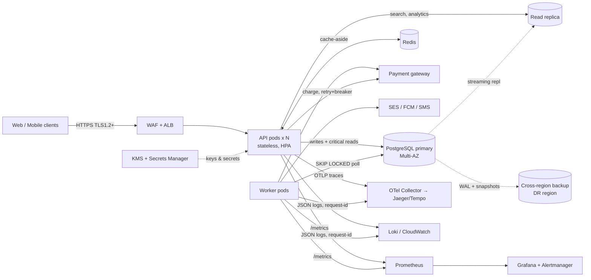

# Amrutam Telemedicine Backend — Architecture

**Stack:** Node.js 22 · Express · PostgreSQL 16 · Redis (optional) · Prometheus/Grafana/OpenTelemetry · Docker/Kubernetes · Terraform (AWS)
**Style:** modular monolith (clear module boundaries + DI) deployed as two processes — `api` (stateless) and `worker` (outbox, sweepers). Modules can be extracted into services later without changing contracts.

## 1. High-level architecture & data flow



**Request path:** WAF/ALB → `request-id` → structured logging → helmet/CORS → body limit → rate limit → RED metrics → route → `authenticate` (JWT, pinned HS256, iss/aud) → `authorize` (RBAC permission) → `requireMfa` (step-up) → zod validation → `idempotent` (writes) → service → repository (parameterised SQL) → error envelope.

**Modules (DI via `src/container.js`):** `auth` (users, MFA, tokens) · `doctors` (slots, search, verification) · `consultations` (booking saga, lifecycle) · `prescriptions` · `payments` (gateway port + resilient wrapper) · `admin` (analytics, audit queries) · `audit` (hash-chained log).

## 2. Booking flow (sequence)

```mermaid
sequenceDiagram
  autonumber
  participant P as Patient
  participant A as API
  participant DB as PostgreSQL
  participant G as Payment Gateway
  participant W as Worker
  P->>A: POST /consultations {slotId} + Idempotency-Key
  A->>DB: INSERT idempotency_keys (IN_PROGRESS) ON CONFLICT DO NOTHING
  A->>DB: BEGIN
  A->>DB: UPDATE slots SET held WHERE id=? AND status='open'  (CAS)
  alt 0 rows (lost race)
    A-->>P: 409 SLOT_UNAVAILABLE
  else won
    A->>DB: INSERT consultation(PENDING_PAYMENT, hold 10m) + payment(INITIATED) + outbox + audit
    A->>DB: COMMIT
    A-->>P: 201 {consultation, payment}
  end
  P->>A: POST /consultations/:id/pay {token} + Idempotency-Key
  A->>G: charge(idempotencyKey = payment.id)  [outside DB tx; retry+backoff+jitter; circuit breaker]
  alt success
    A->>DB: BEGIN; lock consultation FOR UPDATE
    alt still PENDING_PAYMENT
      A->>DB: payment SUCCEEDED, consultation CONFIRMED, slot booked, outbox, audit; COMMIT
      A-->>P: 200 CONFIRMED
    else expired/cancelled meanwhile
      A->>DB: payment SUCCEEDED + outbox(payment.refund) [COMPENSATE]
      A-->>P: 409 HOLD_EXPIRED (refund queued)
    end
  else declined (3rd attempt)
    A->>DB: payment FAILED, consultation CANCELLED, slot open [COMPENSATE]
    A-->>P: 402 PAYMENT_FAILED
  end
  W->>DB: every 15s: expire PENDING holds past deadline → slot open [TIMEOUT COMPENSATION]
  W->>DB: drain outbox (notifications, refunds) with backoff, dead-letter after 8
```

## 3. ER diagram

```mermaid
erDiagram
  users ||--|| profiles : has
  users ||--o| doctors : "is (role=doctor)"
  users ||--o{ refresh_tokens : owns
  doctors ||--o{ availability_slots : offers
  users ||--o{ consultations : "books (patient)"
  doctors ||--o{ consultations : "serves"
  availability_slots ||--o| consultations : "reserved by (1 live)"
  consultations ||--o{ payments : "attempts"
  consultations ||--o| prescriptions : yields
  users ||--o{ audit_logs : "acts (actor_id)"
  users { uuid id PK; text email UK; text role; bool mfa_enabled; text mfa_secret_enc }
  profiles { uuid user_id PK; text full_name; text phone_enc; text dob_enc }
  doctors { uuid user_id PK; text specialization; text license_no UK; int fee_paise; bool is_verified }
  availability_slots { uuid id PK; uuid doctor_id FK; tstz start_time; tstz end_time; text status; int version }
  consultations { uuid id PK; uuid patient_id FK; uuid doctor_id FK; uuid slot_id FK; text status; tstz hold_expires_at; text reason_enc; text notes_enc }
  payments { uuid id PK; uuid consultation_id FK; int amount_paise; text status; text provider_ref }
  prescriptions { uuid id PK; uuid consultation_id UK; text items_enc }
  audit_logs { bigint id PK; tstz created_at PK; uuid actor_id; text action; text prev_hash; text hash }
  idempotency_keys { uuid user_id PK; text key PK; text request_hash; jsonb response_body }
  outbox { bigint id PK; text topic; jsonb payload; text status; int attempts }
```

Integrity enforced **in the database**, not just app code: EXCLUDE constraint (no overlapping slots per doctor), partial UNIQUE index (one live consultation per slot), partial UNIQUE (one SUCCEEDED payment per consultation), CHECK constraints on enums, append-only trigger on `audit_logs`.

## 4. API schema
REST, versioned `/v1`, described in [`openapi.yaml`](../openapi.yaml) (served at `/docs`). Uniform error envelope with `requestId`. Pagination via `page/limit` (hard caps). Idempotency-Key required on booking, payment, cancel, prescription.

## 5. Retry & backoff strategy
| Where | Policy | Why |
|---|---|---|
| Payment gateway calls | Retry **only transient** errors (timeouts/5xx), 3 retries, exponential backoff with **full jitter** (`rand(0, min(5s, 100ms·2^n))`), provider-side idempotency key = `payment.id`; wrapped in a **circuit breaker** (opens after 8 consecutive failures, 15 s cool-down) | Avoid retry storms; never double-charge; fail fast when provider is down (502 to client, slot hold remains) |
| DB transactions | Retry on `40001` serialization / `40P01` deadlock, 3×, 20 ms base | Safe because tx bodies are idempotent units |
| Outbox events | Per-event backoff `rand(0, min(10 min, 2 s·2^n))`, dead-letter after 8 attempts (`status='dead'`, alert on backlog) | At-least-once delivery; consumers idempotent (`processRefund` checks status) |
| Clients | Safe to retry any write with the same `Idempotency-Key` | Network ambiguity |

## 6. Data partitioning & scaling plan
Sizing: 100 k consultations/day ≈ 1.2 rps average, ~15 rps peak (10× burst); with search/reads at ~10:1 → ~150 rps reads. A single well-indexed Postgres primary handles this comfortably; the design targets 10× headroom.
* **`audit_logs`** — implemented: `RANGE (created_at)` monthly partitions (`ensure_audit_partition()`, worker pre-creates next month). Retention = detach old partition → archive to S3 Object Lock (WORM) → drop.
* **`consultations`, `payments`** (~36 M rows/yr) — keep unpartitioned for year 1 (indexed by patient/doctor/time). When > ~200 M rows: `RANGE (scheduled_start)` monthly partitions, PK becomes `(id, scheduled_start)`; hot data stays in recent partitions.
* **`availability_slots`** — not partitioned *by design*: the EXCLUDE overlap constraint is not supported on partitioned tables. Instead: partial index on `status='open'` keeps the hot set tiny; old slots are archived by a job.
* **Read scaling** — `readQuery()` routes search/analytics to a replica (`DATABASE_REPLICA_URL`). Read-your-writes-critical paths (booking/payment) use the primary.
* **Beyond one primary** — shard by `doctor_id` hash (slots/consultations co-located per doctor, which is the contention key); `user_id` for patient history via a lookup/CQRS read model.

## 7. Caching & concurrency
* **Cache-aside** for doctor search (30 s TTL ± 10 % jitter) and admin analytics (60 s); **single-flight** coalescing prevents cache stampedes; invalidation by prefix on slot/booking/verification changes; a cache outage degrades to DB, never to errors. Bookings/payments are **never** served from cache.
* **Double-booking prevention — three layers:** (1) atomic CAS `UPDATE … WHERE status='open'` — only one of N racers gets a row; (2) partial UNIQUE index on `consultations(slot_id)` for live statuses; (3) `FOR UPDATE` row locks on consultation state transitions. Proven by test: 12 concurrent patients → exactly 1×201 and 11×409.
* **Optimistic `version` columns** on slots/consultations for audit and future optimistic concurrency.
* **No DB transaction is held across a network call** (gateway charge happens between two short transactions).

## 8. Transaction management & sagas
Booking is an **orchestrated saga** with local ACID transactions and compensations:

| Step | Local tx | Compensation |
|---|---|---|
| 1 Reserve | slot→held, consultation PENDING_PAYMENT, payment INITIATED, outbox, audit | hold-expiry sweeper (slot→open, EXPIRED) |
| 2 Charge | external call with provider idempotency | failed ×3 → slot→open, CANCELLED |
| 3 Confirm | payment SUCCEEDED, consultation CONFIRMED, slot booked | late success after expiry → queue refund |
| Cancel | slot→open, CANCELLED, outbox(refund) | refund worker retries until REFUNDED |

The **transactional outbox** guarantees events are published iff the state change committed (no dual-write problem). State transitions are validated by a pure state machine (`stateMachine.js`, unit-tested).

## 9. Backup & disaster recovery
| Item | Target | Mechanism |
|---|---|---|
| Availability | 99.95 % (≈ 22 min/month) | Multi-AZ Postgres (auto-failover < 2 min), ≥ 4 API pods across 3 AZs, PDB `minAvailable: 3`, zero-downtime rolling deploys, readiness gates, graceful shutdown |
| RPO | ≤ 5 min | PITR (continuous WAL), 14-day retention, cross-region replicated automated backups |
| RTO | ≤ 60 min regional failure | Terraform re-creates stack in DR region → restore latest backup + WAL → flip DNS (Route 53 health-checked failover) |
| Backups | Daily snapshot + WAL; weekly logical `pg_dump` to S3 (KMS, Object Lock) | **Monthly restore drill** into an isolated env, validated by `GET /v1/admin/audit-logs/verify` + row-count checks |
| Keys | KMS multi-region key; keyring versions kept until all rows re-encrypted | `npm run rotate-keys` |
| Runbook | DB failover → confirm `readyz`; replay `outbox` pending; run hold-expiry sweeper; reconcile payments with provider | see Ops notes |

## 10. Latency budget (p95 reads < 200 ms, writes < 500 ms)
Reads: 1–3 indexed queries (< 10 ms each on warm cache) + JSON ≈ 20–60 ms; cached search ≈ 5 ms. Writes: 1 tx with 4–6 statements + audit append (~15–40 ms) — gateway latency is isolated to `/pay`, which is why booking (reserve) and payment are separate calls. Histogram buckets align to the SLO thresholds; alerts in `observability/alerts.yml`.
**Known trade-off:** the audit hash chain takes a global advisory lock for the last statement of each write tx → serialises audit appends (fine at ~15 rps peak). At 10×+ scale, move to per-shard chains or batch-sealed Merkle roots.

## 11. Observability
* **Metrics:** RED per route template (`http_request_duration_seconds`), `bookings_total{outcome}`, `payments_total{outcome}`, `outbox_pending`, `db_pool_waiting`, `idempotent_replays_total`, Node runtime metrics. Dashboard: `observability/grafana/`.
* **Alerts:** SLO latency, multi-window error-budget burn for 99.95 %, outbox backlog, pool saturation, payment-failure spike.
* **Logs:** pino JSON, `requestId` on every line (also returned as `X-Request-Id`), PII/secret redaction.
* **Traces:** OpenTelemetry auto-instrumentation (http/express/pg/redis) via `OTEL_ENABLED=true`; W3C trace context propagated.
